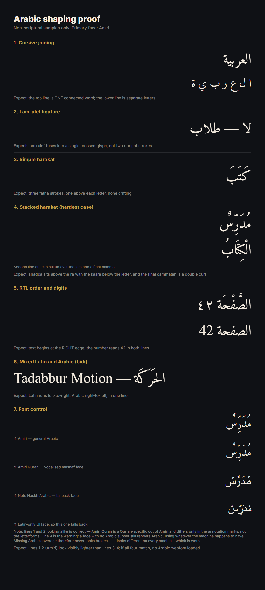

# Arabic shaping — verified



Arabic text renders correctly through Remotion. This was checked by rendering
and **looking at the result**, not by assuming Chromium handles it.

Reproduce with:

```bash
npm run proof:arabic
```

Source: [`src/proofs/ArabicShapingProof.tsx`](../src/proofs/ArabicShapingProof.tsx).
Output lands in `out/`, which is not committed; the copy above is kept so the
expected result is visible without running anything.

## What passed

| # | Check | Result |
|---|---|---|
| 1 | Cursive joining | `العربية` renders as one connected word, distinct from the same letters spaced apart |
| 2 | Lam-alef ligature | `لا` fuses into the single crossed glyph, including inside `طلاب` |
| 3 | Simple harakat | three fatha strokes sit one above each letter |
| 4 | Stacked harakat | shadda above the ra, kasra below the letter, sukun as a circle, final dammatan as a double curl |
| 5 | RTL order | text begins at the right edge; Western digits sit correctly inside the Arabic run |
| 6 | Mixed bidi | Latin runs left-to-right and Arabic right-to-left on one line |
| 7 | Font control | the Amiri lines are visibly lighter than Noto Naskh and the fallback, so the webfonts are genuinely loading |

Worth a native reader's eye: the Arabic-Indic digit line in check 5. Both
digits render, but digit ordering is exactly the kind of detail that deserves
a human read rather than a pixel inspection.

## Three things this turned up

**The missing-font failure is silent.** A typeface loaded without an Arabic
subset still renders Arabic — Chromium falls back to whatever the machine has.
Nothing errors, nothing looks broken, and the output simply differs from
machine to machine. The effects library this project borrows from loads all
six of its faces with `subsets: ['latin']`, so this trap is live in code we
intend to copy from. Arabic coverage is declared explicitly in
[`src/config/fonts.ts`](../src/config/fonts.ts).

**Amiri and Amiri Quran look identical for ordinary text.** That is correct,
not a loading fault: Amiri Quran is a Qur'an-specific cut of Amiri whose
differences are in the annotation marks, not the letterforms. It also ships a
single weight and no italic, which suits scripture — never bolded, never
slanted.

**A still can be captured before webfonts arrive.** That produces fallback
glyphs that look exactly like a shaping failure. Every composition setting
Arabic must gate on `fontsReady` via `delayRender`, as the proof does.

## What this does not license

The engine still never writes Qur'anic text. Every sample in the proof is
ordinary vocabulary or a standard grammar paradigm, chosen so that shaping
could be proved without reproducing scripture from memory.

Verse text must come from an approved source and be verified by a human. The
analysis side already enforces the matching rule: Arabic detected in a
transcript becomes a protected region that is never cut, and is flagged for
source verification in the review report.
