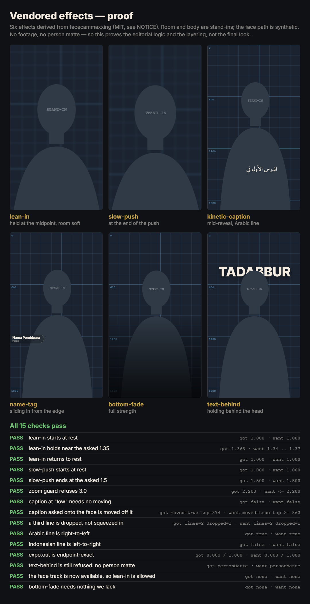
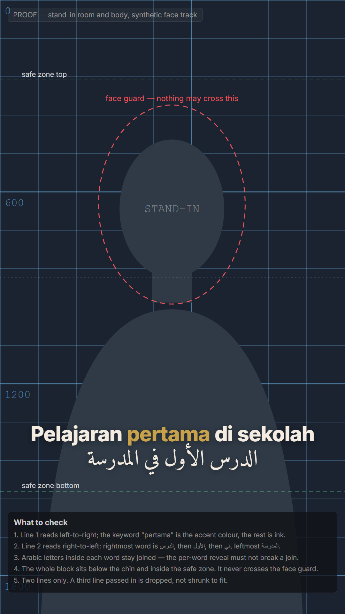

# Vendored effects

Six effects were taken from [facecammaxxing](https://github.com/aaksa/facecammaxxing)
(MIT), which took its foundations from
[claude-video-effects](https://github.com/Vibha-Ramprakash/claude-video-effects)
(MIT). Both notices are in [`NOTICE`](../NOTICE).

| Effect | What it does | Needs |
| --- | --- | --- |
| `lean-in` | Hard punch-in on one word, snaps in and back out | face track |
| `slow-push` | Slow cinematic push-in with parallax | face track |
| `kinetic-caption` | Spoken words appear one at a time, keywords accented | face track |
| `name-tag` | Lower-third pill with name and role | face track |
| `bottom-fade` | Bottom of the frame darkens so captions read | — |
| `text-behind` | A large word rises from behind the body | face track, **person matte** |

Reproduce the proofs with:

```bash
npm run check
```

```bash
npm run proof:caption
```

```bash
npm run proof:effects
```

## This is not a copy



All fourteen numeric checks pass, and the six panels are whole frames at 30%
scale. The room is a ruled grid and the presenter is a flat silhouette, both
labelled: there is no footage in this repository yet.

The rewrite was not tidying. Five things in the reference would have been
wrong here.

**Arabic came out backwards.** The reference lays every caption line out
left-to-right. Arabic rendered that way still draws every glyph and still
joins every letter — it simply reverses the word order. For an engine built
around kajian content that is the single most expensive fault available, and
it is invisible to anyone who does not read the language. Direction is now
decided per line, because a kajian alternates between Indonesian and Arabic
inside one caption.



Read the Arabic line from the right: `الدرس` then `الأول` then `في` then
`المدرسة`. That is the order the words were written in. The words reveal one
at a time, and the split never goes below word level — Arabic letters join to
their neighbours inside a word, so revealing a word letter by letter would
change the shapes on screen.

**Text measurement broke React's rules of hooks.** The reference measures each
line with an async hook called inside the loop that renders the lines, and
silences the lint rule that says not to. It has a quieter second fault: the
cached measurement is keyed by text but read without checking the key, so a
caption whose words change between frames can be laid out at the previous
line's size — which is every caption in a real subtitle track. Both faults
come from measuring asynchronously. Only the font loading is actually async,
so that is the only thing awaited now, once, and measuring is an ordinary
synchronous function.

**The layout was hard-coded to a vertical feed.** The reference bakes in
1080x1920 and the platform's right-hand button rail. This engine renders
portrait and landscape as separate compositions, and a landscape frame has
neither those margins nor a rail. Zones are chosen per format, and sizes scale
by the short edge, so a 40 px label is the same physical size in both.

**Nothing refused an unsafe zoom.** A plan asking for zoom 2 on a close
framing silently crops the forehead. `safeZoom` computes the largest zoom that
keeps the whole head plus air inside frame and clamps to it. Asked for 3.0 on
the proof's framing, it returns 2.200.

**Captions could be placed on the face.** `safeTop` pushes a block below the
chin if its requested position would cross the face guard, and reports that it
moved. Asked to put a caption at the eye line, it returns a top of 874 against
a chin at 862.

## GSAP is not a dependency

The reference calls `gsap.parseEase` for curves named `expo.out`, `power2.in`
and so on. GSAP ships under the GreenSock "Standard 'no charge' License",
which is not MIT and does not belong in an MIT repository without a reason.

None of the six effects uses a GSAP timeline — only named curves. So
[`src/lib/ease.ts`](../src/lib/ease.ts) implements the same families from the
standard formulas, in about sixty lines, with two deliberate differences: the
curves are endpoint-exact, where GSAP's expo family is off by a thousandth at
the ends, and an unknown curve name throws instead of silently animating
linearly. Motion will be very close to the reference. It is not claimed to be
identical frame for frame.

## What is still missing

The **face track** that five of the six effects need now exists — see
[`docs/face-tracking.md`](face-tracking.md). One pass is still missing:

- **Person matte** — an alpha cut-out of the presenter. Without it a `Behind`
  layer is not behind anything. `text-behind` places a word to straddle the top
  of the head on the assumption that the body hides its lower half; with no
  matte that same word lies across the presenter's face.

This gap is carried in code, not only here. Each effect declares what it
needs, `AVAILABLE` in [`src/effects/index.ts`](../src/effects/index.ts) records
what the engine can produce, and `unmetRequirements()` is what a composition
must consult before using an effect. The proof asserts that `text-behind` is
still refused for want of a matte, and that `lean-in` is now allowed.

Being allowed in general is not the same as working on one recording.
`fromArtefact()` in [`src/lib/track.ts`](../src/lib/track.ts) refuses a track
whose `ok` is false, and passes `gaps` through: inside a gap the face position
is held, not known, so an effect promising to stay off the face cannot keep
that promise there.

The proofs still run on `syntheticTrack()`, because there is still no footage
in the repository to track. That function is for proofs and must never reach a
render meant for publishing.

There is also no renderer. These are the editorial moves; applying them to real
footage is milestone 2, and waits on an approved EDL.

## No test runner for TypeScript

The Python side has 52 assertions in two suites. The TypeScript side has
`tsc --noEmit` and the fourteen checks drawn into the proof image, which run
the real code in the real browser but have to be read by a person rather than
by CI. Adding a runner means adding a dependency, so it is left as a decision
rather than taken quietly.
